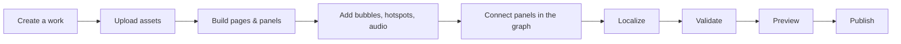

The PanelWave CMS is the authoring environment for interactive graphic novels. You create a **work**, build its chapters, pages, and panels in a visual editor, wire panels together in a navigation graph, translate it, and publish it as a [PanelWave manifest](/concepts/manifest) that the [PanelWave Player](/player/overview) renders for readers.

The CMS embeds the open-source player for previews, so what you see in **Preview** is exactly what readers get.

The CMS is currently in **beta** at app.panelwave.org — the small *beta* tag next to the PanelWave CMS wordmark says so. Places in the beta are given out through the [Founding Creators programme](https://panelwave.org/founding-creators).

In Chrome or Edge you can also [install the CMS as an app](/cms/install-app). It then runs in its own window, without tabs or an address bar.

<Callout kind="alert">
**A large 4K screen is needed for efficient work with the PanelWave CMS.** The editor puts the structure tree, canvas, inspector, and timeline on screen at the same time, and page layouts are authored at print and 4K output resolutions — on a small or low-resolution display you will spend most of your time zooming and scrolling. We recommend a monitor of **27″ or larger at 3840×2160 (4K)**. Laptop screens are fine for reviewing, localization, and Backstage tools, but not for day-to-day authoring.
</Callout>

## The main areas of the app

After signing in you land on the **Dashboard**. A slim **rail** on the left leads to the five app-level screens — **Dashboard**, **Works**, **Exports**, **Team** and **Profile** — and the top bar carries the breadcrumb, the help icon, the notification bell and the user menu. On wide screens the rail shows labels; on narrower ones icons with tooltips (pin it open if you prefer labels).

### Dashboard

Your studio home: the work you touched last with a direct jump back into the editor, creator KPIs, your latest works, readers, your inbox, a next-steps checklist, tutorial videos and the PanelWave blog. See [Dashboard](/cms/dashboard).

### Works

The library of every work of your team: a cover grid, a cover wall or a sortable table, with an inspector that shows everything about the selected work and lets you edit its properties in place. Create new works with the wizard, import existing material, manage statuses, and open the Trash. See [Works](/cms/works).

### The Editor

Opening a work takes you to the visual editor, arranged in four zones:

- **Left sidebar** with three tabs: **Tree** (the structure of chapters, pages, and panels), **Assets** (your media library), and **Tools**.
- **Canvas** in the center, where you arrange artwork layers, speech bubbles, and hotspots on the selected panel or page.
- **Inspector** on the right with **Panel**, **Layer**, **Hotspot**, **Speech**, and **A11y** tabs for editing the selected element's properties, plus a **Perf** tab that estimates what readers download for the open panel or page.
- **Timeline** at the bottom for animations and audio tracks.

The editor header shows the save status (auto-save is enabled), undo/redo, a locale switcher, global search (<kbd>Cmd/Ctrl</kbd>+<kbd>K</kbd>), **Work Properties**, **Preview**, **Preflight**, and **Publish**. See [Editor Layout](/cms/editor/layout).

### Backstage

Every work also has a **Backstage** area — a set of management tools that sit outside the panel-by-panel editor. Its **work rail** on the left groups them by what they are for; small badges on the rail tell you where attention is needed (validation errors, the least complete language, comments awaiting review, bubbles without voice audio, the size of the cast):

| Group | Tools |
|---|---|
| **Create** | **Editor** (back to the visual editor) · **Graph Editor** — the branching navigation between panels ([Graph](/cms/editor/graph)) · **Canvas Layout** — the infinite-canvas board of a chapter ([Canvas Layout Board](/cms/editor/canvas-layout)) |
| **Cast & Content** | **Characters** — the cast board with portraits, balloon styles and voices ([Characters](/cms/characters)) · **Extras** — bonus content such as covers, bonus art, interviews ([Extras](/cms/extras)) · **Variables** — the story's declared state ([Variables & Conditions](/cms/editor/variables)) |
| **Language & Sound** | **Localization** — the translation grid ([Localization](/cms/localization)) · **Audio** — voice takes and text-to-speech per language ([Audio localization](/cms/localization#audio-localization-and-text-to-speech)) |
| **Ship** | **Preview** — the device lab with the embedded player ([Preview](/cms/preview)) · **Validation** — preflight before publishing ([Validation](/cms/validation)) · **Paywall** — rules and products ([Monetization](/cms/monetization)) · **Entitlement** — who sees what, persona by persona ([Simulating reader access](/cms/monetization#simulating-reader-access)) |
| **Audience** | **Comments** — your team's review threads ([Team comments](/cms/community#team-comments-in-the-cms)) · **Analytics** — how the work is read ([Analytics](/cms/analytics)) |

All Backstage tools share one layout — a list on the left, the stage in the middle, an inspector on the right — and the same keys: <kbd>]</kbd> toggles the inspector, <kbd>[</kbd> the list, <kbd>?</kbd> opens the page's **Guide rail**, a short card with what the tool does, why it matters, three next steps, a link to this documentation and a tutorial video. Editing happens in the inspector while the stage stays visible; dialogs are left for creating things and for confirmations.

### Account, Team, and Profile

The user menu (top right, on every screen) leads to **Profile**, **Exports** (your export jobs — see [Export](/cms/export)), and **Team**, plus the theme (light, dark, high contrast), font, interface density and interface scale toggles, keyboard shortcuts in the editor, a **Documentation** link to this site, and logout. See [Account & Team](/cms/account).

### AI assistants

Everything above can also be done by an AI assistant working with you. Claude, ChatGPT, Cursor and other assistants connect to PanelWave's MCP server at `https://mcp.panelwave.org/mcp` and can:

- create a complete work from a script or outline — chapters, pages, panels, characters and speech balloons;
- upload artwork, attach it to the right panels and fit each panel to its image on every page format;
- letter panels, edit layers, hotspots, variables and the story graph, rename characters, reorder structure;
- add languages, machine-translate and review, run Preflight with its automatic fixes, publish a preview or a release.

The assistant works as you, with your team role, plan limits and the permissions you grant. It asks before destructive steps, and you connect, review and disconnect assistants under **Profile → Connected apps & access tokens**. See [AI Assistants (MCP)](/cms/integrations/mcp-overview) and the [tool reference](/cms/integrations/tool-reference).

Most screens also carry a small **help icon** at the top right of their title — click it to open the page of this documentation that describes the screen you are on, in a new tab.

## From idea to published work

1. **Create a work** with the wizard — title, URL slug, languages, page formats, age rating, and tags. Optionally start from a template. See [Works](/cms/works).
2. **Upload your artwork** (and audio, video, fonts) into the Assets library. Files are processed automatically into optimized variants. See [Assets](/cms/assets).
3. **Build the structure**: add chapters, pages, and panels in the Tree tab, then compose each panel from layers on the canvas. See [Pages & Panels](/cms/editor/pages-panels) and [Layers](/cms/editor/layers).
4. **Add dialogue and interactivity**: speech bubbles (with [character](/cms/characters) styling), [hotspots](/cms/editor/hotspots), [animations](/cms/editor/animations), and [audio](/cms/editor/audio).
5. **Connect the story** in the [Graph Editor](/cms/editor/graph) — an entry panel plus edges, optionally with conditions for branching narratives.
6. **Localize** text and audio for every language you support. See [Localization](/cms/localization).
7. **Validate** with Preflight and fix any errors — errors block publishing. See [Validation](/cms/validation).
8. **Preview** the work in the embedded player, then **publish** it. See [Publishing](/cms/publishing) for the current state of the publish flow.

<Callout kind="tip">
New to PanelWave? Follow the step-by-step tutorial: [Your First Graphic Novel](/help-center/guides/first-graphic-novel).
</Callout>

<Callout kind="info">
Every step of this flow is also available to [AI assistants](/cms/integrations/mcp-overview). A typical split: the assistant turns the script into structure, letters the balloons, attaches the art and runs the checks; you review in the editor and Preview and decide what gets published.
</Callout>

## Where your content ends up

Everything you author is stored against the open [PanelWave format](/schema/overview). Publishing produces a `panelwave.json` manifest plus your processed assets; you can also [export](/cms/export) works and later [import](/cms/import) them again — there is no lock-in to the CMS.

<Columns cols={2}>
  <Card title="Works" icon="library" href="/cms/works">Create and manage your projects.</Card>
  <Card title="Editor" icon="square-pen" href="/cms/editor/layout">The four-zone visual editor.</Card>
  <Card title="Publishing" icon="rocket" href="/cms/publishing">Ship your work to readers.</Card>
  <Card title="AI assistants" icon="bot" href="/cms/integrations/mcp-overview">Let Claude, ChatGPT or Cursor work in PanelWave with you.</Card>
</Columns>

